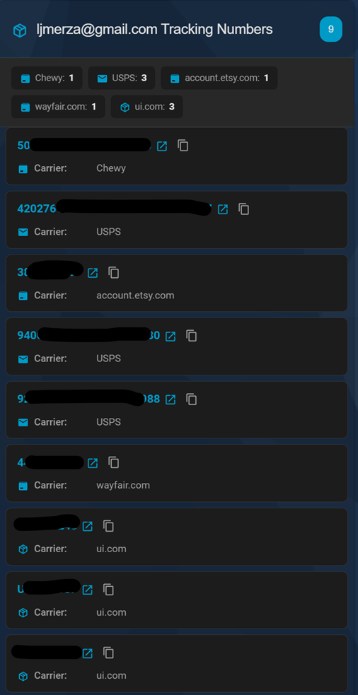

# Tracking Number Card

A modern, customizable Home Assistant Lovelace card for displaying package tracking numbers with clickable links. Requires [tracking-numbers](https://github.com/ljmerza/tracking-numbers) custom integration

## Features

- Clean, modern card design following Home Assistant design language
- Visual configuration UI editor
- Clickable tracking numbers that open package tracking pages
- Copy tracking number to clipboard with one click
- Add manual tracking numbers directly from the card
- Remove or hide entries with a single click
- Display carrier information with icons
- Show estimated and actual delivery dates, including dates read from shipping emails
- Show relative timestamps (e.g., "2 hours ago")
- Summary statistics by carrier
- Fully customizable sorting and display options
- Responsive design for mobile and desktop
- Full theme support (dark/light mode)
- Empty state handling
- Stylized console logging with version info

## Installation

This card requires the [tracking-numbers](https://github.com/ljmerza/tracking-numbers) custom integration to be installed and exposing a sensor with tracking data. HACS is the recommended way to install the card.

## Installation through [HACS](https://github.com/hacs/integration)

1. Open **HACS** in Home Assistant.
2. Go to **Frontend**, click **Explore & Download Repositories**, and search for **Tracking Number Card**.
3. Select it, click **Download**, and choose the latest version.
4. Hard-refresh your browser (Ctrl/Cmd + Shift + R) to clear the cached module.

HACS automatically registers the Lovelace resource `/hacsfiles/tracking-number-card/tracking-number-card.js`. If your dashboard is in YAML mode, add it yourself under **Settings → Dashboards → Resources** as a **JavaScript Module**.

## Manual installation

1. Download `tracking-number-card.js` from the [latest release](https://github.com/ljmerza/tracking-number-card/releases/latest).
2. Copy it to `config/www/tracking-number-card.js`.
3. Go to **Settings → Dashboards → Resources → Add Resource**.
4. Set the URL to `/local/tracking-number-card.js` and the type to **JavaScript Module**.
5. Hard-refresh your browser.

### Configuration Options

| Option | Type | Default | Description |
|--------|------|---------|-------------|
| `entity` | string | **Required** | Entity ID with tracking number data |
| `title` | string | Entity friendly name | Custom card title |
| `show_summary` | boolean | `true` | Show summary statistics by carrier |
| `show_carrier` | boolean | `true` | Display carrier information for each package |
| `show_origin` | boolean | `true` | Display retailer or sender information when available |
| `show_delivery_source` | boolean | `true` | Tag the estimated delivery date with where it came from (`from email` or `from carrier`) |
| `highlight_arrivals` | boolean | `true` | Highlight undelivered packages whose estimated delivery is today ("Arriving today") or already past ("Overdue") |
| `show_dates` | boolean | `true` | Show last updated timestamps |
| `sort_by` | string | `first_seen` | Sort field: `first_seen`, `carrier`, `tracking_number`, or `estimated_delivery` |
| `sort_direction` | string | `desc` | Sort direction: `asc` or `desc` |
| `max_items` | number | unlimited | Maximum number of packages to display |

### Delivery dates

Each package can show these rows when the integration provides the data:

- **Est. delivery**: the `estimated_delivery` date. If the package also has `estimated_delivery_source`, a small `from email` or `from carrier` tag follows the date (hide it with `show_delivery_source: false`). A date from a live carrier status provider takes priority over one read from an email.
- **Delivered**: the `delivered_date`, set when the integration sees a "Delivered" email.
- **Status chip**: packages with a `delivered_date` but no `delivery_status` get the same green "Delivered" chip as packages whose carrier reports `delivered`. When a carrier status is present, the chip uses it.

With `sort_by: estimated_delivery`, packages with an estimated delivery come first (soonest date first), then packages without one, then delivered packages. `sort_direction` doesn't reverse this order. It only orders packages that tie (same date, or both without a date) by first seen.

With `highlight_arrivals` on, a package that isn't delivered yet gets a colored left border and a badge: "Arriving today" when its estimated delivery is today, or "Overdue" when the date has passed. The card compares dates using your browser's local date. A package counts as delivered when it has a `delivered_date` or its `delivery_status` is `delivered`.

`estimated_delivery_source` and `delivered_date` need a version of [tracking-numbers](https://github.com/ljmerza/tracking-numbers) that reads delivery dates from emails. Older versions don't send these fields, and the card shows nothing extra for them.

## Contributing

Contributions are welcome! Please feel free to submit a Pull Request.

## Release Process

- Update the version in `package.json` and commit your changes.
- Create and push a version tag, for example `git tag 4.2.2 && git push origin 4.2.2` (a `v`-prefixed tag such as `v4.2.2` also works).
- The GitHub Actions workflow builds the distribution files and publishes a release with the generated assets.

## License

MIT License - see LICENSE file for details

## Support

For issues, feature requests, or questions:
- GitHub Issues: [tracking-number-card/issues](https://github.com/ljmerza/tracking-number-card/issues)
